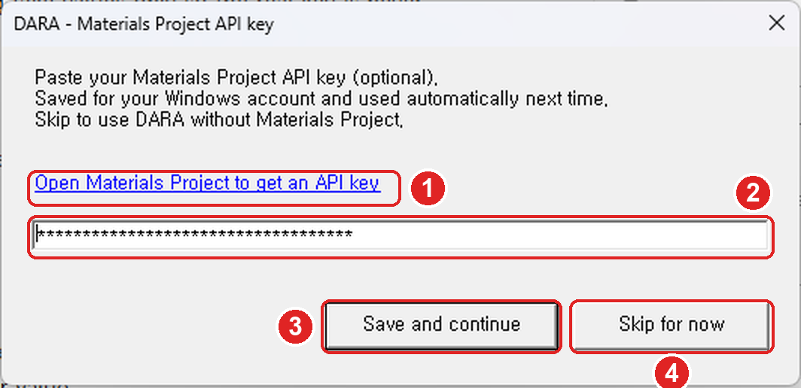
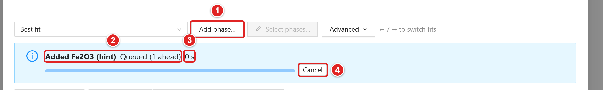
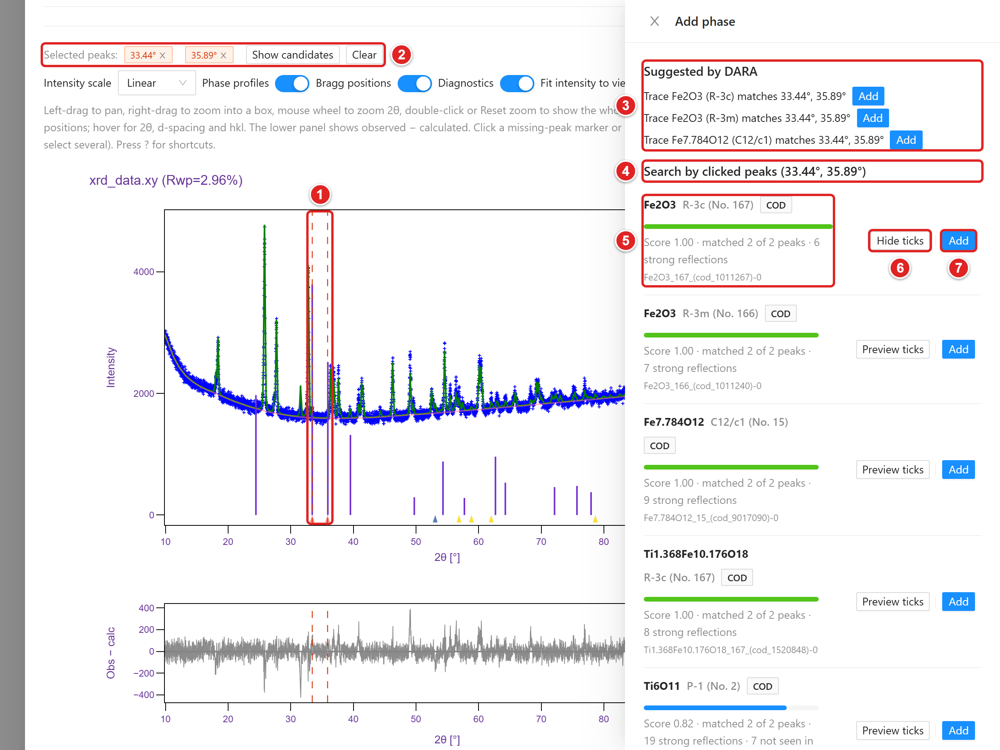

# DARA 한글 사용 설명서

분말 XRD 상 동정과 Rietveld 정밀화를 자동으로 수행하는 웹 프로그램

> 기준 버전: 저장소 main 브랜치(2026-10-30). 저장소 [youngboong/dara](https://github.com/youngboong/dara).
> 화면 문구는 앱의 영어 표기를 그대로 적음. 예: Submit, Results, High confidence.

| 장 | 내용 |
| --- | --- |
| 01 개요 | DARA의 용도와 주요 기능 |
| 02 준비물 | 필수·선택 준비물, MP API 키, GEQ, CIF |
| 03 설치와 실행 | 내려받기, START.cmd 첫 실행, MP 키, 종료와 스위치 |
| 04 분석 제출 | 분석 모드, 전구체 양, DB, 속도 조절, 장비·파장, 2θ 범위, CIF, 재실행 |
| 05 시리즈 분석 | 여러 패턴 일괄 제출과 추세 그래프 |
| 06 결과 보기 | 결과 목록, 신뢰도 배너와 상별 판정, 미설명 피크, 그래프 조작, 질량 균형, 빠른 재정밀화와 버전, 상 추가·교체·제거, 두 피팅 비교, 실패 작업 재시도 |
| 07 보고서와 내보내기 | 논문형 보고서, 그림, CSV, 외부 프로그램용 파일 |
| 08 결과 해석 시 주의 | 상대 wt%, 불확도, 계산 구조, 질량 균형 해석, 검토 원칙 |
| 09 문제 해결 | 자주 겪는 상황과 대처 |

## 01 개요

분말 X선 회절(XRD) 패턴에서 결정상 후보를 자동으로 찾고 BGMN 엔진으로 Rietveld 정밀화까지 끝내는 웹 프로그램. Ceder 그룹이 공개한 원본(Chemistry of Materials, 2026)에 설치, 입력 형식, 결과 검토, 보고서 기능을 더한 맞춤판. 자동 결과를 그대로 확정하는 도구는 아니며, 판정 근거를 함께 보여 줘 검토할 곳을 좁혀 줌.

- 패턴 한 개 또는 여러 개(시리즈)를 올려 상 동정과 정량을 한 번에 수행
- 분석 모드 3종: Phase identification, Known-phase refinement, Reaction check
- 결과마다 신뢰도 배너(High confidence / Check recommended / Expert review recommended)와 상별 판정
- 설명되지 않은 피크를 significant / minor / instrument / noise로 구분하고 미량상 후보 제시
- 완료된 작업에서 상 추가·제거·교체 후 바로 재정밀화. 결과는 버전으로 쌓이고 두 피팅을 나란히 비교
- 논문형 영문 보고서, 그림(PNG/SVG), CSV 표, Profex·TOPAS·GSAS-II·HighScore용 내보내기

상단 메뉴는 Submit, Results, Series, Tutorial, Documentation 순서. 서버 주소는 http://localhost:8898.

> 이 설명서의 그림은 2026-10-27~10-30 화면을 캡처한 것. 시료 이름과 수치는 조작 설명용이며 검증된 분석 결과로 인용하면 안 됨.

## 02 준비물

| 구분 · 항목 | 내용 |
| --- | --- |
| 필수 · Windows PC | Windows 10/11 64비트. 여유 공간 약 3 GB. 폴더 경로는 짧게(예: C:\DARA), OneDrive 동기화 폴더 밖에 둘 것. |
| 필수 · 인터넷(첫 실행) | uv, Python 3.12, 패키지, BGMN을 내려받음(약 1 GB). 설치 후 실행은 오프라인도 가능. COD/MP 구조 검색에는 계속 인터넷 필요. |
| 필수 · 측정 패턴 | .xrdml 권장. 다른 지원 형식은 4장 참고. |
| 필수 · 시료 정보 | 포함 원소, 전구체나 예상 화학식, 측정 파장. Reaction check라면 열처리 온도와 분위기도 필요. |
| 선택 · MP API 키 | Materials Project 계산 구조를 후보에 넣을 때 사용. 없으면 COD만으로 분석 가능. |
| 선택 · 장비 프로파일(GEQ/GER) | 기본 목록에 실제 장비·광학계와 맞는 항목이 없을 때만 등록. |
| 선택 · 참조 CIF | DB에 없는 상이나 연구실에서 검증한 구조를 추가할 때 사용. |

Python, Git, Anaconda를 미리 설치할 필요 없음. START.cmd가 필요한 도구를 DARA 폴더 안에 직접 설치함.

### MP API 키 받기

MP API 키는 무료이고 가입하면 자동으로 만들어짐. 키 입력은 3장 START.cmd 첫 실행 때 함.

1. 브라우저에서 [https://materialsproject.org](https://materialsproject.org/) 접속. 처음 접속하면 사람 확인(Cloudflare) 화면이 잠깐 나올 수 있음.
2. 오른쪽 위 로그인 메뉴에서 가입·로그인. 이메일 또는 연동 계정 중 편한 방식 선택.
3. 로그인한 상태에서 위쪽 메뉴의 API 클릭(주소 [https://next-gen.materialsproject.org/api](https://next-gen.materialsproject.org/api)).
4. API Key 항목의 "Your API Key" 상자에 표시된 영문·숫자 문자열 전체를 복사. 앞뒤 공백 없이 한 줄 그대로.
5. 복사한 키는 START.cmd 첫 실행 때 뜨는 입력 창에 붙여 넣음(그림 1).

- 키는 비밀번호처럼 다룰 것. 공개 문서, 메신저, Git에 올리지 말 것.
- 키가 새어 나갔거나 바꾸고 싶으면 같은 페이지 아래 dashboard 링크에서 새 키를 받고 예전 키를 폐기. 새 키는 START.cmd -SetApiKey로 다시 넣음(3장).

### GEQ 장비 파일 구하기

먼저 Instrument profile 목록에서 실제 장비, 검출기, 슬릿 조건과 맞는 항목을 찾음. 있으면 등록 불필요. 없으면 장비 담당자에게 BGMN/Profex용 .geq(대응 .ger 포함)를 요청하거나, [Profex](https://www.profex-xrd.org/)의 Instrument → Edit Configuration에서 실제 하드웨어 값으로 생성. .xrdml 측정 파일의 확장자를 바꿔서는 .geq가 되지 않음.

### 참조 CIF 구하기

[COD](https://www.crystallography.net/cod/), 논문 보충자료, 이용권이 있다면 ICSD에서 확보. 원소, 공간군, 출처를 확인한 뒤 사용. 검색 결과 HTML을 .cif로 이름만 바꾼 파일은 읽히지 않음.

## 03 설치와 실행

### 내려받기

[https://github.com/youngboong/dara](https://github.com/youngboong/dara)에서 Code → Download ZIP 선택. 내려받은 ZIP을 오른쪽 클릭해 "모두 압축 풀기". 압축 파일 안에서 바로 실행하면 설치가 실패함. START.cmd, src, scripts, pyproject.toml이 한 폴더에 보이면 준비 완료.

### START.cmd 실행

START.cmd를 더블클릭. 첫 실행은 아래 순서로 자동 진행되며 5~15분 걸림. 진행 중에는 창을 닫지 말 것.

| 단계 | 내용 |
| --- | --- |
| 1. uv, Python | uv와 CPython 3.12를 DARA 폴더의 tools\ 안에 설치. 시스템 PATH와 레지스트리는 건드리지 않음 |
| 2. .venv | 프로젝트 환경 생성. 패키지 버전 고정 |
| 3. BGMN | 정밀화 프로그램이 없으면 내려받음 |
| 4. MP 키 | 처음 한 번 키 입력 창 표시(그림 1): Save and continue 또는 Skip for now |
| 5. 시작 화면 | 서버가 준비되면 http://localhost:8898로 전환 |

중간에 끊겨도 START.cmd를 다시 실행하면 받은 파일을 재사용해 이어서 진행함. 기록은 artifacts\launcher\setup-날짜-시각.log에 남음. 두 번째 실행부터는 설치를 건너뛰고 1초 안팎에 서버가 뜸.

### MP 키 입력

START.cmd 첫 실행의 4단계에서 아래 창이 한 번 뜸.

{height=170}

(1) Open Materials Project to get an API key: 키가 아직 없으면 눌러서 MP 사이트 열기(2장 MP API 키 받기 순서대로 진행).
(2) 키 입력 칸: 복사한 키를 Ctrl+V로 붙여 넣기. 화면에는 점으로만 보임.
(3) Save and continue: 키를 저장하고 설치 계속. 빈 칸이면 저장되지 않고 안내 문구가 뜸.
(4) Skip for now: 키 없이 진행. 이후 실행에서는 다시 묻지 않음.

- 저장 위치: Windows 사용자 환경변수 MP_API_KEY. 다음 실행부터 자동 사용. DARA 폴더나 Git에는 저장되지 않음.
- 확인: Submit 화면 MP 스위치 옆 태그. MP key valid면 정상, MP key rejected면 키가 틀렸거나 폐기됨, MP key not configured면 키 없음, MP key not verified면 인터넷 문제로 확인 실패. Re-check를 누르면 다시 조회함.
- Skip for now를 골랐다면 Reference databases에서 MP를 끄고 COD로 분석.

### MP 키 바꾸기·나중에 넣기

키를 잘못 넣었거나, 새 키를 받았거나, 처음에 Skip for now를 눌렀다면 입력 창을 다시 열어 키를 넣음.

1. DARA 폴더(START.cmd가 있는 폴더)를 탐색기로 열기.
2. 탐색기 주소창에 cmd를 입력하고 Enter. 그 폴더 위치로 명령 창이 열림.
3. START.cmd -SetApiKey 입력 후 Enter. 그림 1의 입력 창이 다시 뜸.
4. 새 키를 붙여 넣고 Save and continue. Skip for now를 누르면 기존 키를 그대로 둠.
5. DARA 서버가 이미 켜져 있었다면 "Restart required" 안내가 뜸. 서버 창(START 창)을 닫고 START.cmd를 다시 실행해야 새 키가 적용됨.

### 종료, 여러 창, 스위치

- 마지막 DARA 브라우저 창을 닫고 약 20초 뒤 서버가 스스로 종료됨. 분석이 대기·실행 중이면 끝날 때까지 유지. 바로 끄려면 START 창에서 Ctrl+C.
- START.cmd를 다시 실행하면 이미 떠 있는 서버에 새 창만 열림. 한 창에서 제출하고 다른 창에서 결과를 보는 병행 사용 가능.
- 선택 스위치: -Reinstall(.venv 재설치), -Offline(네트워크 미사용), -SetupOnly(설치만), -NoBrowser(브라우저 안 엶), -SkipApiKeySetup(MP 키 입력 창 생략), -SetApiKey(MP 키 입력 창 다시 열기).

## 04 분석 제출

{height=470}

(1) User: 제출자 식별용 이름 입력.
(2) XRD pattern: 측정 파일을 끌어 놓거나 눌러서 선택.
(3) Analysis mode: Phase identification, Known-phase refinement, Reaction check 중 선택.
(4) Included elements / Precursor / expected formulas: 원소 기호와 예상 화학식 입력.
(5) Reference databases: COD·MP 사용 여부와 MP E-hull cutoff, Maximum MP structures 설정.
(6) Candidate pre-filter, Reference screening limit (s), Maximum analysis time (min): 속도 조절 3종.

### 패턴 올리기

지원 형식은 .xrdml, .xy, .xye, .txt, .csv, .dat, .asc, .scn, .ras, .rasx, .brml, .raw(Bruker RAW v2만). 읽기에 실패하면 몇 번째 줄이 문제인지 알려 줌.

- XRDML이면 메타데이터로 가장 가까운 Instrument profile과 Wavelength가 자동 선택됨. 실제 슬릿·광학계와 다르면 직접 수정.
- Data quality pre-check (advisory): 강도 정규화, S/N, 스텝 간격, 측정 범위 경고. 참고용이며 제출을 막지 않음.
- 파일 이름에서 화학식을 읽어 원소를 제안함(예: BiFeO3_800C_60min.xrdml → Bi, Fe, O). 실제 시료와 대조 후 사용.

### Analysis mode 고르기

| 모드 | 쓰임과 입력 |
| --- | --- |
| Phase identification | 원소계 안에서 가능한 상을 탐색. Included elements 필수(예: Bi, Fe, O). Precursor / expected formulas에 적은 상은 후보에 반드시 포함됨. |
| Known-phase refinement | 구성 상을 이미 알 때. Phases to refine에 적은 상만 정밀화. 미지 불순물은 찾지 않음. |
| Reaction check | 전구체, Temperature (°C), Atmosphere로 생성물을 예측한 뒤 피팅. 후보가 20~60개 수준이라 가장 빠름. MP 데이터 사용. |

잔류 전구체나 홀더 성분의 원소를 Included elements에서 빠뜨리면 그 상은 처음부터 후보에서 빠짐.

### Reference databases

COD(experimental)는 실험 구조, MP(computed supplement)는 계산 구조 보충용. MP E-hull cutoff 기본값 0.05 eV/atom, Maximum MP structures 기본값 100. 값을 늘리면 후보와 계산 시간이 함께 늘어남. 이 값은 상이 존재할 확률과 무관함.

{height=250}

(1) Included elements: 원소 기호 입력(예: Fe, Ti, O).
(2) Precursor / expected formulas: 전구체와 양 입력. 예시는 Fe2O3 1몰, TiO2 2몰.
(3) 도움말 아이콘. 마우스를 올리면 입력 형식 안내가 뜸.
(4) 도움말 내용: 화학식 앞 몰 계수(Fe2O3, 2 TiO2) 또는 콜론 뒤 칭량 질량(In2O3:0.3022g, TiO2:0.2004g).

### 전구체 양 입력

Precursor / expected formulas에 전구체 양을 함께 적으면 결과에서 질량 균형을 점검함(6장). 양이 없으면 점검을 건너뜀.

- 몰 계수: Fe2O3, 2 TiO2 (계수가 없는 항목은 1)
- 칭량 질량: In2O3:0.3022g, TiO2:0.2004g (단위 g, mg, mol, mmol. 생략하면 g)
- 양은 모든 항목에 적어야 함. 일부만 적으면 점검 생략. 한 항목에 계수와 질량을 함께 쓰면 오류.
- 칸에 양이 없으면 파일 이름에서 읽음(예: 2Fe3O4-3Y2O3_1000C_60min, In2O3_0p3022-TiO2_0p2004). 칸 입력이 파일 이름보다 우선함. 주의점은 8장 참고.

### 속도 조절 3종

<!-- widths: 140,347 -->
| 항목 | 동작 |
| --- | --- |
| Candidate pre-filter | 기본 켜짐. 계산 패턴의 강한 피크가 측정 패턴에 없으면 그 참조 구조를 미리 제외. 업로드·라이브러리·전구체 상은 제외하지 않음. |
| Reference screening limit (s) | 선별 단계에서 참조 하나에 쓰는 BGMN 최대 시간. 기본 300 s, 입력 범위 60~1200. |
| Maximum analysis time (min) | 5~720분. 시간이 지나면 그때까지의 최선 결과를 미완료 표시와 함께 반환. 비우면 제한 없음. |

예상 후보 수와 실행 시간 범위(예: "Estimated run time 8 min–33 min (typically 16 min) on 12 workers")는 조건을 바꿀 때마다 갱신됨. 대략적인 값.

{height=460}

(1) 예상 후보 수와 Estimated run time 안내. 조건을 바꾸면 갱신됨.
(2) Instrument profile: 장비 조건 선택. 맞는 항목이 없으면 Register instrument profile로 등록.
(3) Final refinement controls: Lattice parameters, Preferred orientation, Sample peak broadening.
(4) Synchrotron / Wavelength: 광원과 파장 지정.
(5) Analysis range · 2θ (°) / Excluded intervals · 2θ (°): 분석 범위와 제외 구간.
(6) Reference library CIFs / Additional reference CIFs: 참조 CIF 추가.
(7) Submit: 누른 뒤 확인 창에서 확정하면 작업 생성.

### 장비 프로파일과 파장

- Instrument profile에서 실제 장비 조건 선택. 맞는 항목이 없으면 Register instrument profile에서 Compiled GEQ (required)와 Matching GER (optional)을 올려 등록. 등록은 교정이 아니므로 표준시료 피팅으로 따로 확인 필요.
- 실험실 광원은 Wavelength에서 Cu, Co, Cr, Fe 등 선택. Synchrotron을 켜면 Wavelength (nm)에 직접 입력(1 Å = 0.1 nm).
- XRDML의 파장과 선택한 파장이 다르면 제출 때 "The selected wavelength differs from the file" 창이 뜸. Submit anyway 또는 Go back and check 선택.

### 2θ 범위, 최종 정밀화 조건

- Analysis range · 2θ (°)를 비우면 측정 범위 전체 사용. 홀더나 장비 아티팩트가 확인된 위치만 Add excluded interval로 제외. 범위나 제외 구간이 다른 작업끼리는 Rwp를 직접 비교하지 말 것.
- Final refinement controls는 처음엔 Keep saved/default 유지. 결과에서 문제를 확인한 뒤 한 항목씩 바꿔 비교. 자유도를 늘려 Rwp가 내려가도 상 동정이 입증되지는 않음.

### 참조 CIF 넣기

Reference library CIFs는 서버에 저장해 여러 작업에서 다시 쓰는 구조(Manage library → Add CIF to library). Additional reference CIFs(Select CIF files)는 이번 작업에만 쓰는 구조. 같은 상의 CIF를 여러 개 넣으면 정량값이 쪼개지므로 상 하나에 하나만 넣을 것.

### 제출과 조건 재사용

맨 아래 Submit을 누르고 확인 창에서 확정. 기존 작업 페이지의 Copy conditions & rerun을 누르면 원래 패턴과 조건이 채워진 Submit 화면이 열림. 바꿀 항목만 고쳐 제출하면 원본은 그대로 둔 채 새 작업이 생김.

## 05 시리즈 분석

온도별, 시간별, 조성별처럼 같은 조건으로 측정한 패턴 여러 개를 한 번에 분석하고 추세를 볼 때 사용.

- Submit 화면에서 Submit as a series를 켬.
- Series name 입력 후 XRD patterns에 파일 2~50개를 한꺼번에 올림. 형식과 측정 조건이 같아야 함.
- Series order preview에 파일 이름에서 읽은 변수(예: 200 °C, 60 min)와 순서가 표시됨. 그래프 축에만 쓰이고 분석에는 영향 없음.
- 각 파일은 같은 설정의 독립 작업으로 처리됨.

상단 Series 메뉴에서 시리즈를 고르면 작업 표와 추세 그래프 3종이 나옴. Phase fractions는 상별 wt%와 오차막대, Lattice parameters는 격자 변화, Fit quality는 시료별 Rwp와 GOF. 완료된 작업이 2개 이상일 때 그려짐. Export CSV로 표를 받고, Compare patterns로 패턴을 겹쳐 볼 수 있음.

## 06 결과 보기

{height=270}

(1) Filter file name / Filter username: 파일 이름·사용자로 검색.
(2) Compare selected / Export table: 체크한 작업 겹쳐 보기, 결과 표 CSV 저장.
(3) Status: 작업 상태 태그(COMPLETED, FIZZLED 등).
(4) Best Rwp (%) / GOF: 최저 Rwp 결과의 적합도.
(5) Final phases: 최종 정밀화된 상.
(6) Adopted: 채택 결과 여부.
(7) Actions: 결과 Download, 작업 Delete.

| Status | 의미 |
| --- | --- |
| READY / RUNNING | 대기 중 / 분석 중. 작업 페이지에서 진행 단계 확인. 필요하면 Stop analysis |
| COMPLETED | 완료. 신뢰도 배너부터 확인 |
| FIZZLED | 실패. 태그에 마우스를 올리면 원인 요약 표시. 재시도는 이 장 끝 참고 |
| CANCELLING / CANCELLED | 중단 처리 중 / 중단됨 |

{height=300}

(1) Copy conditions & rerun: 같은 패턴·조건으로 Submit 화면 열기.
(2) Download all results: 계산 산출물 전체 ZIP.
(3) Table (CSV), Figure (PNG), Figure (SVG): 결과 표와 피팅 그림 저장.
(4) Export for...: Profex, TOPAS, GSAS-II, HighScore용 내보내기.
(5) 신뢰도 배너. 등급과 그 등급을 정한 이유 표시.
(6) How is this assessed?: 판정 기준 설명 열기.
(7) Adopted result & lab notes: 채택 후보 선택과 메모.

### 신뢰도 배너

배너 아래 항목이 그 등급을 정한 이유. 확률이 아니라 통계량에 대한 문턱값 판정.

| 등급 | 조건(하나라도 해당하면 그 등급) |
| --- | --- |
| High confidence | 아래 두 등급 조건에 하나도 해당하지 않음. GOF 3 이하, significant 미설명 피크 없음, 모든 상 Confident. |
| Check recommended | Ambiguous 또는 Weak evidence 상 존재(5 wt% 미만), GOF 3 초과, significant 피크 1~3개, 시료 변위 Warning, 넓은 배경 언덕, 선별 시간 초과 참조 존재, 최대 분석 시간에 걸려 중단, 질량 균형 편차 0.20 초과. |
| Expert review recommended | 5 wt% 이상 상이 Weak evidence, significant 피크 4개 이상 또는 높이 합 20% 이상, Rwp 25% 초과, GOF 4 초과, 시료 변위 Severe, 최종 정밀화 절반 이상 실패, 참조 25% 이상 미선별. |

### 상별 판정(Verdict)

정밀화된 상마다 Confident, Ambiguous, Weak evidence 중 하나가 붙음. 태그에 마우스를 올리면 근거 수치가 보임.

- wt%를 표준편차로 나눈 값이 3 이상이면 Confident 쪽, 2 미만이거나 1 wt% 미만이면 Weak.
- 그 상이 빠진 다른 후보의 Rwp가 거의 같으면 Ambiguous. 툴팁에 대안 후보 이름 표시.
- MP 계산 구조는 격자가 참조값에서 1.5% 넘게 움직이면 감점.

{height=320}

(1) Check recommended 배너.
(2) 등급을 낮춘 이유: significant 미설명 피크 2개(31.93°, 46.58°).
(3) Fit diagnostics의 Unexplained 태그: significant·minor 피크 수.
(4) Refinement quality 지표: Rwp, Rp, Rexp, GOF, χ², DW, 2θ 범위, 데이터 점 수, 반복 수.
(5) Specimen displacement 태그: 시료 변위(mm).
(6) Review cautions (automated checks, not a verdict): 자동 점검 결과 모음.

### 미설명 피크 등급

Unexplained 태그는 계산 패턴이 재현하지 못한 관측 피크 수. 높이(최강 피크 대비)와 S/N으로 분류함.

<!-- widths: 90,397 -->
| 등급 | 기준과 영향 |
| --- | --- |
| significant | 최강 피크의 2% 이상이면서 S/N 8 이상. 등급 판정에 반영되는 유일한 종류 |
| minor | noise와 significant 사이. 정보로만 표시 |
| instrument | 강한 반사의 Cu Kβ, W Lα1 위치와 일치하는 약한 피크. 장비 유래 가능성 |
| noise | 최강 피크의 0.5% 미만이거나 S/N 3 미만 |

미설명 피크 위치가 어떤 상의 강한 반사와 맞으면 "Positions are consistent with trace ..." 형태로 미량상 후보를 알려 줌. 판정에는 반영되지 않음. 이 PC에 받아 둔 구조만 비교하므로 한 번도 받지 않은 구조는 힌트로 나오지 않음. 힌트 상은 Add phase로 넣어 확인.

### Review cautions와 시료 변위

- Review cautions: 자동 점검 결과 모음. 예: Durbin–Watson 1 미만(esd 과소평가 가능), 넓은 배경 언덕, 미설명 피크 요약.
- Specimen displacement: 0.3 mm 이하 OK, 0.3 mm 초과 Info, 1.0 mm 초과 Warning, 2.0 mm 초과 Severe. 변위가 크면 모든 피크가 함께 밀리므로 격자상수와 상 매칭을 조심해서 읽고, 시료 높이와 장비 프로파일부터 재확인.

{height=420}

(1) Verdict: 상별 판정(Confident, Ambiguous, Weak evidence).
(2) Quantity / Lattice parameters: wt%와 격자상수, 표준편차.
(3) Compare fits: 비교 창 열기. 처음에는 A에 Best fit, B에 다음 후보가 들어감. 후보가 둘 이상일 때 사용 가능.
(4) Confidence: 후보별 신뢰도 태그. 열 머리글로 정렬 가능.
(5) View fit: 후보 피팅 보기.

### 후보 비교와 채택

- Candidate comparison 표는 Rwp, GOF, Missing, Extra, Intensity mismatch, Cautions, Confidence 열로 정렬 가능. 모든 후보에 같은 기준의 신뢰도 태그가 붙음.
- Adopted result & lab notes에 메모를 적고 Save review로 저장.
- 채택 버튼은 Versions 표의 Adopt(그림 13)와 비교 창의 Adopt B(그림 16) 두 곳에만 있음. 후보를 채택하려면 비교 창에서 그 후보를 B로 고른 뒤 Adopt B. 자동 최저 Rwp 결과와 채택 결과는 따로 저장됨.

## 06 결과 보기 · 피팅 그래프와 질량 균형

{height=330}

(1) Fit intensity to view: 기본 켜짐. 보이는 2θ 구간에 맞춰 강도 축을 자동 조정.
(2) Reset zoom: 전체 패턴으로 복귀. 그래프를 더블클릭해도 같음.
(3) 조작 안내 문구. 마우스 조작, 범례 클릭, hover 정보 요약.
(4) 오른쪽 버튼 끌기로 그린 확대 상자(파란 점선). 버튼을 놓으면 그 범위로 확대, 끄는 중에 Esc를 누르면 취소.
(5) 아래 패널(관측-계산). 여기서 그린 상자는 2θ 범위만 바꿈.
(6) 그림 저장(카메라) 버튼. Plotly 도구 모음에는 이 버튼만 남음.

### 그래프 조작

<!-- widths: 150,337 -->
| 동작 | 결과 |
| --- | --- |
| 왼쪽 버튼 끌기 | 그래프 이동 |
| 오른쪽 버튼 끌기 | 확대 상자. Esc로 취소 |
| 마우스 휠 | 2θ 확대·축소 |
| 더블클릭, Reset zoom | 전체 패턴 보기로 복귀 |
| 범례의 상 이름 클릭 | 그 상의 프로파일과 Bragg 위치 표시 |
| 점에 마우스 올리기 | 2θ, d(Å), 강도 표시. Bragg 반사 표시에서는 hkl도 나옴 |

피팅 창과 비교 창 모두 같은 방식으로 움직임. 피팅 창에서 ?를 누르면 단축키 목록이 열림.

{height=200}

(1) 신뢰도 배너. caution 수준이라 등급은 High confidence 그대로.
(2) 배너 이유 목록에 붙은 "Mass balance: …" 문장. 상 분율로 계산한 Fe:Y = 0.67:0.33, 파일 이름의 전구체 비율 0.50:0.50, 최대 편차 0.17.
(3) Review cautions의 같은 내용(info).

### 질량 균형 점검 읽기

전구체 양을 입력했거나 파일 이름에서 읽을 수 있을 때만 동작함. 정밀화된 wt%를 원소 몰분율로 바꿔 전구체의 원소 비와 비교하고, 원소별 차이 중 가장 큰 값(최대 편차)으로 등급을 정함. O, H, C, N은 비교에서 제외.

<!-- widths: 110,377 -->
| 최대 편차 | 결과 |
| --- | --- |
| 0.10 이하 | 메시지 없음 |
| 0.10~0.20 | caution. 배너 이유와 Review cautions에 한 줄 추가. 등급은 바뀌지 않음 |
| 0.20 초과 | warning. 종합 등급은 최소 Check recommended |

- 예: Fe2O3 + 2 TiO2가 Fe2TiO5 + TiO2로 반응했다면 75/25 wt%가 나와야 함. 26.8/73.2로 정량되면 Fe:Ti = 0.18:0.82(편차 0.32)라 warning.
- 경고가 뜨면 먼저 입력한 전구체 양을 확인. 원인 해석은 8장 참고.

## 06 결과 보기 · 결과 수정과 버전

완료된 작업에서 상을 더하거나 빼고 그 자리에서 다시 정밀화할 수 있음(빠른 재정밀화). 결과는 같은 작업 안에 v2, v3 … 버전으로 쌓이고 원래 자동 분석(v1)은 그대로 남음.

{height=110}

(1) Add phase…: 상 추가 창 열기(그림 14).
(2) 진행 막대의 작업 이름(Added Fe2O3 (hint))과 현재 단계. 여기서는 앞선 기준 재계산을 기다리는 중(Queued (1 ahead)).
(3) 경과 시간. 실행 단계에 들어가면 남은 시간 추정(… left 또는 estimating…)도 함께 나옴.
(4) Cancel: 진행 중인 재정밀화 취소.

### 빠른 재정밀화

- 시작하는 곳: 피팅 창의 Add phase…, Select phases…, 상 표의 Swap·Remove, Advanced → Background….
- DB 검색은 다시 하지 않고 바꾼 상 조합만 정밀화. 패턴, 장비, 파장, 2θ 범위, 제외 구간, Final refinement controls는 원래 값 그대로.
- 대부분 수십 초 안에 끝남(Task 9: 상 2개 16 s, 상 3개 21~24 s). 한 작업에서는 한 번에 하나만 실행.
- 피팅 창을 닫아도 계속 진행됨. Cancel하면 버전이 만들어지지 않음.
- 끝나면 "Version vN ready (Rwp …%)" 알림과 함께 새 버전이 열림. Select phases…, Swap, Remove로 만든 버전은 비교 창이 바로 열림.
- Select phases…: 이 작업에 저장된 참조 상 목록에서 넣을 상만 체크하고 Re-refine and compare. 의심스러운 상을 빼 보거나 다른 참조로 바꿔 비교할 때 유용함.
- Advanced → Background…: 배경 다항식 항 수와 제외 구간 변경. 항 수를 늘리면 계산이 크게 느려지고, 배경을 바꾼 버전의 Rwp는 같은 조건의 피팅끼리만 비교.
- 2026-10-28 이전에 끝난 작업은 첫 재정밀화 때 원래 상 조합을 현재 코드로 다시 계산한 "Baseline (current code)" 버전이 먼저 만들어지고, 이후 비교의 기준이 됨.

{height=150}

(1) 표시할 피팅 선택. Best fit, 후보, 버전(v2, v3 …) 순으로 나열.
(2) Change from the base fit: 기준 피팅 대비 Rwp, GOF, χ², 미설명 피크 수, 상별 wt% 변화. 좋아진 값은 초록, 나빠진 값은 주황. 여기서 기준은 자동 기준 재계산 버전 v2.
(3) 이 버전의 신뢰도 등급. 버전마다 새로 판정함.

{height=250}

(1) Versions 제목과 채택 표시(v3 adopted).
(2) 채택한 버전의 Version 칸에 붙는 ★.
(3) Origin: 버전을 만든 방법.
(4) Rwp (%), GOF, Phases, Unexplained: 버전별 적합도, 상 목록, 미설명 피크 수.
(5) View / Compare: 피팅 창에서 열기 / 비교 창 열기. A는 채택 결과, 채택이 없으면 기준 피팅.
(6) Adopt: 이 버전을 채택하고 현재 lab notes도 함께 저장. 채택된 행에는 Adopted로 표시.
(7) Report: 이 버전의 논문형 보고서.
(8) Export: 이 버전을 Profex, TOPAS, GSAS-II, HighScore 형식으로 내보내기.
(9) 삭제(휴지통). v1과 채택 중인 버전은 삭제 불가.

### Versions 표

작업 페이지의 Final refined phase parameters 표 아래에 있음. Origin은 Automatic(v1), Hint, Peak search, Swap / Remove, Background, Manual(Select phases…, 기준 재계산) 중 하나. 채택한 버전은 Report (saved choice)와 선택을 지정하지 않은 내보내기에 쓰임. 채택 중인 버전을 지우려면 다른 결과를 먼저 채택해야 함.

## 06 결과 보기 · 상 추가와 교체

{height=380}

(1) 고른 피크 위치(빨간 점선). 보라색 세로선은 Preview ticks로 띄운 후보의 반사 위치.
(2) Selected peaks: 고른 피크 칩(×로 하나씩 해제), Show candidates, Clear.
(3) Suggested by DARA: 미량상 힌트 목록. Add를 누르면 그 상을 넣어 재정밀화.
(4) Search by clicked peaks: 고른 피크 위치로 찾은 후보 목록.
(5) 후보 정보: 화학식, 공간군, 출처(This task, Library, COD), 점수 막대, 맞은 피크 수, 강한 반사 수, 참조 이름.
(6) Preview ticks / Hide ticks: 후보의 반사 위치를 그래프에 겹쳐 보기.
(7) Add: 이 후보를 넣어 재정밀화.

### Add phase 창

피팅 창의 Add phase…를 누르거나 그래프에서 피크를 클릭하면 오른쪽에 열림.

- Suggested by DARA: 미량상 힌트가 줄마다 나오고 오른쪽에 Add가 붙음. 추가한 버전의 라벨은 "Added … (hint)".
- Search by clicked peaks: 미설명 피크 표시(삼각형)나 관측점을 클릭하면 그 피크로 후보 검색. Shift+클릭으로 피크를 더함(최대 10개). 첫 검색은 15초까지 걸릴 수 있음.
- 점수 = (맞은 피크 비율) - 0.5 × (그 상의 강한 반사 중 측정 신호가 없는 비율). 1.0 근처는 고른 피크를 모두 설명하고 모순 반사도 없다는 뜻이라 넣어 볼 만함. 0.5 이하는 일부만 우연히 겹친 경우가 대부분.
- 점수만으로 존재를 판정하지 말고 Preview ticks로 다른 반사 위치도 확인. Add로 넣은 뒤 비교 창에서 Rwp가 뚜렷하게 내려가고 화학적으로도 타당할 때만 채택.
- 이 PC에 받아 둔 구조(작업 후보, 입력 CIF, 참조 라이브러리, 로컬 COD 캐시)만 찾음. 실제 상이 여기에 없으면 피크를 골라도 찾을 수 없음. 해당 상의 CIF를 구해 입력 CIF나 참조 라이브러리로 추가할 것.
- 로컬 CIF가 없는 후보나 다른 재정밀화가 도는 중에는 Add가 꺼짐.

{height=330}

(1) Ambiguous 판정. 거의 같은 Rwp로 다른 모델을 쓴 후보가 있음.
(2) Swap: 같은 화합물의 다른 구조 모델로 바꿔 재정밀화 후 비교.
(3) Remove: 이 상을 빼고 재정밀화 후 비교. 상이 2개 이상일 때만 표시.
(4) View candidate N: 대안 후보 N의 저장된 피팅 보기. 다시 계산하지 않음.

### Swap, Remove, View candidate

<!-- widths: 110,377 -->
| 버튼 | 동작 |
| --- | --- |
| Swap | 같은 화합물의 다른 구조 모델(다른 공간군·다형)로 이 상만 바꿈 |
| Remove | 이 상만 빼고 다시 정밀화 |
| View candidate N | 대안이 다른 상 조합인 후보 N의 저장된 피팅으로 화면만 바꿈. 새 버전 없음 |

Swap이나 Remove가 끝나면 원래 피팅(A)과 새 버전(B)의 비교 창이 바로 열림.

## 06 결과 보기 · 두 피팅 비교

{height=420}

(1) Fit A / Fit B 선택 상자. Best fit, 후보, 버전 중에서 고름.
(2) 판정 태그(A fits better, B fits better, Similar fit). 괄호 안은 B - A의 Rwp 차이.
(3) Adopt B / Keep A / View B. B 채택, 채택 변경 없이 닫기, B를 피팅 창에서 열기.
(4) 지표 표: Rwp, GOF, χ², 상별 wt%, Mass balance, Unexplained peaks, Cautions.
(5) 관측점과 두 계산 패턴. A는 파란 실선, B는 주황 점선.
(6) 두 피팅의 관측-계산 잔차.
(7) 두 계산 패턴이 가장 크게 다른 2θ 위치. 누르면 그 구간으로 확대. 그래프에서는 노란 띠로 표시.

### 비교 창 읽기

- 여는 곳: Candidate comparison 표 위의 Compare fits, Versions 표의 Compare. Select phases…, Swap, Remove가 끝났을 때도 자동으로 열림.
- 같은 작업의 두 피팅만 비교함. 다른 시료끼리는 Results의 Compare selected 사용.
- Keep A를 눌러도 B 버전은 Versions 표에 남음.
- 노란 띠는 두 모델이 다른 구간일 뿐 어느 쪽이 맞다는 증거는 아님. Rwp 하나보다 잔차, 화학 조성, 물리적 타당성을 함께 볼 것.

{height=200}

(1) 실패 원인 요약과 조치 힌트.
(2) Copy conditions & rerun: 원래 패턴과 조건이 채워진 Submit 화면 열기. 자동 조치가 있는 원인이면 왼쪽에 Retry with suggested fix (…) 버튼이 함께 나옴.
(3) Results 목록의 Copy conditions & rerun. 자동 조치가 있으면 앞에 Retry with fix가 붙음.

### 실패 작업 재시도

Retry with suggested fix (…)는 자동 조치가 있는 원인일 때만 보임. 바꿀 설정을 보여 준 뒤 Retry with fix로 확정하면 새 작업이 생김. 실패한 작업은 그대로 남음. 자동 조치가 없으면 Copy conditions & rerun에서 값을 고쳐 제출.

<!-- widths: 150,337 -->
| 원인 | 자동 조치 |
| --- | --- |
| 계산 시간 초과 | 선별 시간 제한 2배, Maximum analysis time 1.5배 |
| MP 키 문제, 네트워크 오류 | MP 끄기 |
| 메모리 부족 | Candidate pre-filter 켜기, MP 구조 수 최대 50 |
| 후보 구조 없음 | COD 켜기, MP 구조 수 늘리기 |
| 모든 후보 최종 정밀화 실패 | 격자 변화 3% 제한 |
| EFLECH 시간 초과, 피크 없음, BGMN·Ray 오류 | 자동 조치 없음. 2θ 범위를 좁히거나 잡음 구간을 제외해 재제출 |

## 07 보고서와 내보내기

{height=320}

(1) 제목 "XRD phase analysis — 파일 이름"과 작성 정보 줄(Task 번호 · 생성 날짜 · DARA 버전).
(2) 1. Summary: 종합 판정, 상별 wt% ± esd, Rwp·GOF, 질량 균형 요약.
(3) 2. Experimental and methods: 측정·정밀화 방법 문단. 참고문헌 번호 [1]~[5]가 붙음.
(4) Table 1. Analysis conditions: 분석 모드, 원소, 전구체, DB, 장비 프로파일, 파장, 2θ 범위, 최종 정밀화 조건 등.

### 논문형 보고서

Best-fit report는 자동 최저 Rwp 결과를, Report (saved choice)는 채택한 결과를 내보냄. 피팅 창의 This fit's report와 Versions 표의 Report는 보고 있는 피팅이나 그 버전을 내보냄. 인터넷 없이 열리는 단일 HTML 파일이며, PDF가 필요하면 브라우저에서 Ctrl+P → PDF로 저장.

<!-- widths: 150,337 -->
| 절 | 내용 |
| --- | --- |
| 1. Summary | 종합 판정, 상별 정량, Rwp·GOF, 질량 균형 요약 |
| 2. Experimental and methods | DARA·BGMN 버전, 파장, 장비, 데이터 범위, 정밀화 변수를 문장으로 정리. Table 1 Analysis conditions |
| 3. Results | 피팅 그림, Table 2 Fit statistics, Table 3 Phase quantification |
| 4. Assessment | 4.1 Phase verdicts, 4.2 Mass balance, 4.3 Unexplained peaks, 4.4 Review cautions |
| 5. Limitations | 상대 wt%, esd 범위 등 해석상 한계 |
| 6. References | DARA, BGMN, COD, Materials Project, pymatgen 등 |

{height=250}

(1) 범례: Observed, Calculated, Background, Difference.
(2) 관측(검은색)과 계산(빨간색) 패턴. 가장 강한 반사 부근 예시.
(3) Background: 회색 배경 곡선.
(4) 상별 Bragg 반사 위치(tick).
(5) Difference: 관측값에서 계산값을 뺀 차이 곡선.

### 그림, 표, 외부 프로그램용 파일

- Figure (PNG): 600 dpi 피팅 그림. Figure (SVG): 같은 그림의 벡터 버전.
- Table (CSV): 상별 wt%, 표준편차, 격자상수, 품질 지표. Results 목록의 Export table은 여러 작업을 한 표로 묶음.
- Download all results: 계산 산출물 전체(.lst 포함) ZIP.

<!-- widths: 170,317 -->
| Export for... 항목 | 내용 |
| --- | --- |
| Profex / BGMN (.sav + .str) | Profex에서 바로 여는 프로젝트와 구조 파일 |
| TOPAS (.inp starting model) | TOPAS 시작 모델 입력 파일 |
| GSAS-II (CIF + data) | 정밀화된 CIF와 패턴 데이터 |
| HighScore (CIF + data) | 정밀화된 CIF와 패턴 데이터 |

서버 데이터는 사용자 홈의 .dara-server 폴더에 있으며 Git 저장소와 별개.

## 08 결과 해석 시 주의

- wt%는 상대값: 모델에 넣은 결정상끼리 합이 100%가 되도록 정규화한 값. 비정질이나 미동정 물질은 빠져 있음. 배경에 넓은 언덕이 보이면 비정질 성분을 의심.
- ± 값은 BGMN 추정 표준편차. 우선 배향, 미세흡수, 시료 변위, 잘못된 구조 모델 같은 계통 오차는 포함되지 않음. Durbin–Watson 주의가 뜨면 실제 불확도는 더 큼.
- MP 계산 구조는 격자가 몇 % 어긋나는 일이 흔함. 최종 상이 계산 구조뿐이면 같은 화학식의 실험 CIF로 재정밀화해 보는 편이 안전함.
- 후보는 COD, MP, 사용자가 넣은 CIF에서만 나옴. significant 미설명 피크가 남으면 원소 목록 누락이나 새로운 상 가능성을 검토.

### 질량 균형 편차 해석

caution이나 warning은 비율이 어긋났다는 사실만 알려 줌. 원인은 직접 좁혀야 함.

- 휘발 손실: 고온에서 Bi, Pb, Li, Na, K 등이 일부 날아가면 편차 자체가 실제 현상일 수 있음.
- 비정질·미동정 상: 그 상에 들어간 원소가 계산에서 빠져 비율이 치우침. 배경 언덕, significant 미설명 피크와 함께 확인.
- 미반응·누락 상: 남은 전구체나 중간상이 모델에 없으면 편차가 커짐. 힌트가 있으면 Add phase…로 넣어 비교.
- 정량 문제: 우선 배향, 미세흡수, 잘못된 구조 모델 때문에 wt%가 틀릴 수 있음. Ambiguous 상이나 Durbin–Watson 주의가 함께 있으면 이쪽을 먼저 의심.
- 입력 문제: 파일 이름에서 양을 읽을 때 숫자 없는 화학식은 계수 1로 처리함. Fe2O3-TiO2_800C_60min.xrdml은 1:1(몰)로 해석되므로 실제 비율이 다르면 근거 없는 경고가 뜸. 이름에 계수를 넣거나(예: Fe2O3-2TiO2_...) 칸에 양을 직접 적을 것.

### 자동 결과는 검토 대상

High confidence도 정답 보증이 아님. 시료 이력, 합성 조건, 가능하면 다른 분석법(SEM-EDS, XRF 등) 결과와 대조. 낮은 Rwp 하나로 상 조합을 확정하지 말고 미설명 피크, 강도 차이, 판정 근거를 함께 볼 것. 최종 판단과 채택 근거는 lab notes에 남겨 둘 것.

## 09 문제 해결

<!-- widths: 140,347 -->
| 상황 | 확인과 대처 |
| --- | --- |
| 첫 실행이 실패함 | 인터넷과 프록시 확인 후 START.cmd 재실행(받은 파일 재사용). 원인은 START 창의 마지막 메시지와 artifacts\launcher\setup-*.log에서 확인. |
| 폴더를 옮긴 뒤 실행 안 됨 | START가 자동 재구성함. 그래도 안 되면 START.cmd -Reinstall 또는 .venv 폴더 삭제 후 재실행. |
| MP key rejected / not configured | DARA 폴더에서 START.cmd -SetApiKey로 키를 다시 넣고 서버를 다시 시작(3장 MP 키 바꾸기). 급하면 MP를 끄고 COD와 CIF로 분석. |
| 서버가 혼자 꺼짐 | 모든 DARA 창을 닫으면 약 20초 뒤 종료되는 정상 동작. START.cmd로 다시 실행. 비정상 종료로 "Unexpected shutdown of the worker process"가 뜬 작업은 다시 제출. |
| 웹 화면이 안 열림 | http://localhost:8898을 직접 입력. 회사 프록시가 로컬 주소를 가로채는지 확인. |
| 분석이 너무 느림 | 전구체를 알면 Reaction check. Candidate pre-filter 켜기, MP 구조 수 줄이기, Maximum analysis time 지정, 2θ 범위 좁히기 순으로 시도. |
| COD 연결 오류, CERTIFICATE_VERIFY_FAILED | 인터넷·프록시 확인. 기관망 HTTPS 검사 환경이면 START.cmd로 다시 실행(인증서 묶음 자동 생성). 계속 실패하면 CIF를 직접 올려 분석. |
| No candidate structures were found | 원소 목록, COD/MP 스위치 확인. 그래도 없으면 참조 CIF 업로드. |
| BGMN refinement program failed | 이상한 CIF나 프로파일·파장 불일치가 흔한 원인. 의심 CIF를 빼고 장비 프로파일 확인. |
| The parallel worker (Ray) could not start | 다른 DARA 창을 닫거나 PC 재시작. 보안 프로그램이 로컬 포트를 막는지 확인. |
| 질량 균형 경고가 뜸 | 전구체 양과 파일 이름 속 계수가 실제 칭량과 같은지 확인. 다르면 Copy conditions & rerun에서 양을 적어 재제출. 입력이 맞으면 8장 참고. |
| 재정밀화가 오래 걸리거나 실패함 | 배경 항 수를 Auto로 되돌리거나 불필요한 상을 Remove. 다른 재정밀화가 도는 중에는 버튼이 꺼지므로 기다리거나 Cancel. 실패 알림 문구 확인 후 재시도. |
| 실패 작업을 다시 돌리고 싶음 | Retry with suggested fix 또는 Copy conditions & rerun(6장 실패 작업 재시도). |
| 피팅이 나쁨 | 파장, 장비 프로파일, 원소 목록, 후보 CIF, 분석 범위 순으로 점검. Rwp를 낮추려고 중요한 피크를 제외 구간으로 지우지 말 것. |

### 폴더 안내

START.cmd만 실행하면 됨. src, scripts, pyproject.toml은 지우거나 옮기지 말 것. tools와 .venv는 첫 실행 때 생기는 폴더. 분석 DB는 사용자 홈의 .dara-server에 있으므로 백업은 서버를 끈 뒤 그 폴더를 따로 복사.

> 문서 근거: README.md, docs/user-guide/results-confidence.md, scripts/start_dara_web.ps1, src/dara/server 소스. PDF 재생성: python docs/user-guide/build_manual.py(reportlab 필요).
