# DARA 한글 사용 설명서

분말 XRD 상 동정과 Rietveld 정밀화를 자동으로 수행하는 웹 프로그램

> 기준 버전: 저장소 main 브랜치(2026-10-27). 저장소 [youngboong/dara](https://github.com/youngboong/dara).
> 화면 문구는 앱의 영어 표기를 그대로 적음. 예: Submit, Results, High confidence.

| 장 | 내용 |
| --- | --- |
| 01 개요 | DARA의 용도, 사용 대상, 화면 구성 |
| 02 준비물 | 필수·선택 준비물, MP API 키, GEQ, CIF 확보 방법 |
| 03 설치와 실행 | START.cmd, 첫 실행 과정, 자동 종료, 여러 창 |
| 04 분석 제출 | 분석 모드, 원소·전구체, DB, 속도 조절, 장비·파장, CIF |
| 05 시리즈 분석 | 여러 패턴 일괄 제출과 추세 그래프 |
| 06 결과 보기 | 결과 목록, 신뢰도 배너, 상별 판정, 미설명 피크, 재정밀화 |
| 07 보고서와 내보내기 | 논문형 보고서, 그림, CSV, 외부 프로그램용 파일 |
| 08 결과 해석 시 주의 | 상대 wt%, 비정질, 계산 구조, 검토 원칙 |
| 09 문제 해결 | 자주 겪는 상황과 대처 |

## 01 개요

### DARA란

분말 X선 회절(XRD) 패턴에서 결정상 후보를 자동으로 찾고 BGMN 엔진으로 Rietveld 정밀화까지 끝내는 웹 프로그램임. Ceder 그룹이 공개한 원본(Chemistry of Materials, 2026)을 바탕으로 설치, 입력 형식, 결과 검토, 보고서 기능을 크게 늘린 맞춤판임.

### 사용 대상

XRD는 직접 측정하지만 Rietveld 전용 소프트웨어는 익숙하지 않은 연구자에게 맞춤. 전문가에게는 빠른 1차 분석과 후보 비교 도구로 쓸모 있음. 자동 결과를 그대로 확정하는 도구는 아님. 판정 근거를 함께 보여 주므로 검토할 곳이 좁혀짐.

### 주요 기능

- 패턴 한 개 또는 여러 개(시리즈)를 올려 상 동정과 정량을 한 번에 수행
- 분석 모드 3종: Phase identification, Known-phase refinement, Reaction check
- 후보 사전 필터, 참조별 선별 시간 제한, 최대 분석 시간, 제출 전 예상 시간 표시
- 결과마다 신뢰도 배너(High confidence / Check recommended / Expert review recommended)와 상별 판정
- 설명되지 않은 피크를 significant / minor / instrument / noise로 구분하고 미량상 후보 제시
- 논문형 영문 보고서, 그림(PNG/SVG), CSV 표, Profex·TOPAS·GSAS-II·HighScore용 내보내기

### 화면 구성

상단 메뉴는 Submit, Results, Series, Tutorial, Documentation 순서. 서버 주소는 http://localhost:8898. 브라우저 창을 여러 개 열어도 같은 서버를 공유함.

> 이 설명서의 그림은 2026-10-27 현재 화면을 캡처한 것. 시료 이름과 수치는 조작 설명용이며 검증된 분석 결과로 인용하면 안 됨.

## 02 준비물

| 구분 · 항목 | 내용 |
| --- | --- |
| 필수 · Windows PC | Windows 10/11 64비트. 여유 공간 약 3 GB. 폴더 경로는 짧게(예: C:\DARA), OneDrive 동기화 폴더 밖에 둘 것. |
| 필수 · 인터넷(첫 실행) | uv, Python 3.12, 과학 계산 패키지, BGMN을 내려받음. 안내 문구 기준 약 1 GB, 실측은 670 MB 안팎. 설치 후 실행은 오프라인도 가능. COD/MP 구조 검색에는 계속 인터넷 필요. |
| 필수 · 측정 패턴 | .xrdml 권장. 다른 지원 형식은 4장 참고. |
| 필수 · 시료 정보 | 포함 원소, 전구체나 예상 화학식, 측정 파장. Reaction check라면 열처리 온도와 분위기도 필요. |
| 선택 · MP API 키 | Materials Project 계산 구조를 후보에 넣을 때 사용. 없으면 COD만으로 분석 가능. |
| 선택 · 장비 프로파일(GEQ/GER) | 기본 목록에 실제 장비·광학계와 맞는 항목이 없을 때만 등록. |
| 선택 · 참조 CIF | DB에 없는 상이나 연구실에서 검증한 구조를 추가할 때 사용. |

Python, Git, Anaconda를 미리 설치할 필요 없음. START.cmd가 필요한 도구를 DARA 폴더 안에 직접 설치함.

### MP API 키 받기

[Materials Project](https://materialsproject.org/)에 가입·로그인한 뒤 대시보드에서 API 키를 복사. 첫 실행 때 뜨는 대화상자에 붙여 넣으면 끝. 키는 공개 문서나 Git에 올리지 말 것.

### GEQ 장비 파일 구하기

먼저 Instrument profile 목록에서 실제 장비, 검출기, 슬릿 조건과 맞는 항목을 찾음. 맞는 항목이 있으면 등록 불필요. 없으면 장비 담당자에게 BGMN/Profex용 .geq(대응 .ger 포함)를 요청하거나, [Profex](https://www.profex-xrd.org/)의 Instrument → Edit Configuration에서 실제 하드웨어 값으로 생성. .xrdml 측정 파일의 확장자를 바꿔서는 .geq가 되지 않음.

### 참조 CIF 구하기

[COD](https://www.crystallography.net/cod/), 논문 보충자료, 이용권이 있다면 ICSD에서 확보. 원소, 공간군, 출처를 확인한 뒤 사용. 검색 결과 HTML을 .cif로 이름만 바꾼 파일은 읽히지 않음.

## 03 설치와 실행

### 내려받기

[https://github.com/youngboong/dara](https://github.com/youngboong/dara)에서 Code → Download ZIP 선택. 내려받은 ZIP을 오른쪽 클릭해 "모두 압축 풀기". 압축 파일 안에서 바로 실행하면 설치가 실패함. START.cmd, src, scripts, pyproject.toml이 한 폴더에 보이면 준비 완료.

### START.cmd 실행

START.cmd를 더블클릭. 첫 실행은 아래 순서로 자동 진행되며 5~15분 걸림. 진행 중에는 창을 닫지 말 것.

| 단계 | 내용 |
| --- | --- |
| 1. uv | 고정 버전 uv를 받아 SHA-256 확인 후 tools\uv에 저장 |
| 2. Python | CPython 3.12를 tools\python에 설치. 시스템 PATH, 레지스트리, 사용자 프로필은 건드리지 않음 |
| 3. .venv | 프로젝트 환경 생성. 패키지 버전은 scripts\constraints-py312-win.txt로 고정 |
| 4. BGMN | src\dara\bgmn\BGMNwin에 정밀화 프로그램이 없으면 내려받음. 실행할 때마다 확인 |
| 5. MP 키 | 처음 한 번 대화상자 표시: Save and continue 또는 Skip for now |
| 6. 시작 화면 | 진행 페이지가 먼저 열리고, 서버가 준비되면 http://localhost:8898로 전환 |

중간에 끊겨도 START.cmd를 다시 실행하면 받은 파일을 재사용해 이어서 진행함. 단계별 기록은 artifacts\launcher\setup-날짜-시각.log에 남음(최근 10개 보관). 두 번째 실행부터는 설치를 건너뛰고 1초 안팎에 서버가 뜸.

### MP 키 저장과 확인

키는 Windows 사용자 환경변수 MP_API_KEY에 저장되고 다음 실행부터 자동 사용. 저장 시점에는 온라인 검증을 하지 않음. Submit 화면 MP 스위치 옆 태그로 상태 확인 가능: MP key valid, MP key rejected, MP key not configured, MP key not verified. Re-check를 누르면 다시 조회함. Skip for now를 고른 경우 그 선택도 기억되므로 Reference databases에서 MP를 끄고 COD로 분석.

### 창을 닫으면 자동 종료

마지막 DARA 브라우저 창을 닫고 약 20초 뒤 서버가 스스로 종료됨. 창이 비정상적으로 사라진 경우에는 약 3분 안에 종료. 대기 중이거나 실행 중인 분석이 있으면 끝날 때까지 서버 유지. 바로 끄려면 START 창에서 Ctrl+C.

### 여러 창 사용

START.cmd를 다시 실행하면 이미 떠 있는 서버에 새 창만 추가로 열림. 서버가 중복으로 뜨지 않음. 한 창에서 제출하고 다른 창에서 결과를 보는 식의 병행 사용 가능.

### START 스위치(선택)

<!-- widths: 110,377 -->
| 스위치 | 용도 |
| --- | --- |
| -Reinstall | .venv를 새로 만들고 패키지 재설치. tools\와 다운로드 캐시는 유지되어 오프라인에서도 가능 |
| -Offline | 네트워크를 쓰지 않음. 빠진 구성 요소가 있으면 이유를 표시하고 종료 |
| -SetupOnly | 설치·확인만 하고 서버는 띄우지 않음 |
| -NoBrowser | 브라우저 창을 열지 않음 |
| -SkipApiKeySetup | MP 키 대화상자 생략 |

## 04 분석 제출

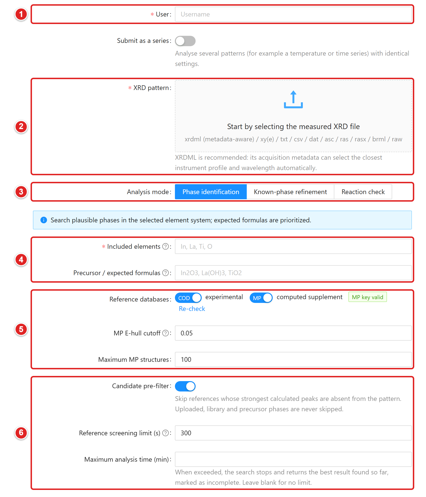{height=470}

(1) User: 제출자 식별용 이름 입력.
(2) XRD pattern: 측정 파일을 끌어 놓거나 눌러서 선택.
(3) Analysis mode: Phase identification, Known-phase refinement, Reaction check 중 선택.
(4) Included elements / Precursor / expected formulas: 원소 기호와 예상 화학식 입력.
(5) Reference databases: COD·MP 사용 여부와 MP E-hull cutoff, Maximum MP structures 설정.
(6) Candidate pre-filter, Reference screening limit (s), Maximum analysis time (min): 속도 조절 3종.

### 패턴 올리기

User에 식별용 이름을 적고 XRD pattern 영역에 파일을 끌어 놓음. 지원 형식은 .xrdml, .xy, .xye, .txt, .csv, .dat, .asc, .scn, .ras, .rasx, .brml, .raw(Bruker RAW v2만). 텍스트 형식은 머리글, 쉼표·탭 구분, 소수점 표기 차이를 웬만큼 견딤. 읽기에 실패하면 몇 번째 줄이 문제인지 알려 줌.

### 업로드 직후 확인할 것

- XRDML이면 장비·검출기·파장 메타데이터로 가장 가까운 Instrument profile과 Wavelength가 자동 선택됨. 실제 슬릿·광학계와 다르면 직접 수정.
- Data quality pre-check (advisory): 정규화된 강도인지, S/N, 스텝 간격, 측정 범위를 점검해 경고 표시. 참고용이며 제출을 막지 않음.
- 파일 이름에서 화학식을 읽어 원소를 제안함(예: BiFeO3_800C_60min.xrdml → Bi, Fe, O). 실제 시료와 대조 후 사용.

### Analysis mode 고르기

| 모드 | 쓰임과 입력 |
| --- | --- |
| Phase identification | 원소계 안에서 가능한 상을 탐색. Included elements 필수(예: Bi, Fe, O). Precursor / expected formulas는 선택이며, 적어 둔 상은 후보에 반드시 포함됨. |
| Known-phase refinement | 구성 상을 이미 알 때. Phases to refine에 적은 상만 정밀화. 미지 불순물이나 반응 생성물은 찾지 않음. |
| Reaction check | 전구체, Temperature (°C), Atmosphere로 생성물을 예측한 뒤 피팅. 후보가 20~60개 수준이라 가장 빠름. MP 데이터 사용. |

Included elements에는 원소 기호(Bi, Fe, O), 화학식 칸에는 화학식(Bi2O3, Fe2O3)을 넣음. 잔류 전구체나 홀더 성분의 원소를 빠뜨리면 그 상은 처음부터 후보에서 빠짐.

### Reference databases

COD(experimental)는 실험 구조, MP(computed supplement)는 계산 구조 보충용. MP E-hull cutoff 기본값 0.05 eV/atom, Maximum MP structures 기본값 100. 값을 늘리면 후보와 계산 시간이 함께 늘어남. 이 값은 상이 존재할 확률과 무관함.

## 04 분석 제출 · 속도와 장비 조건

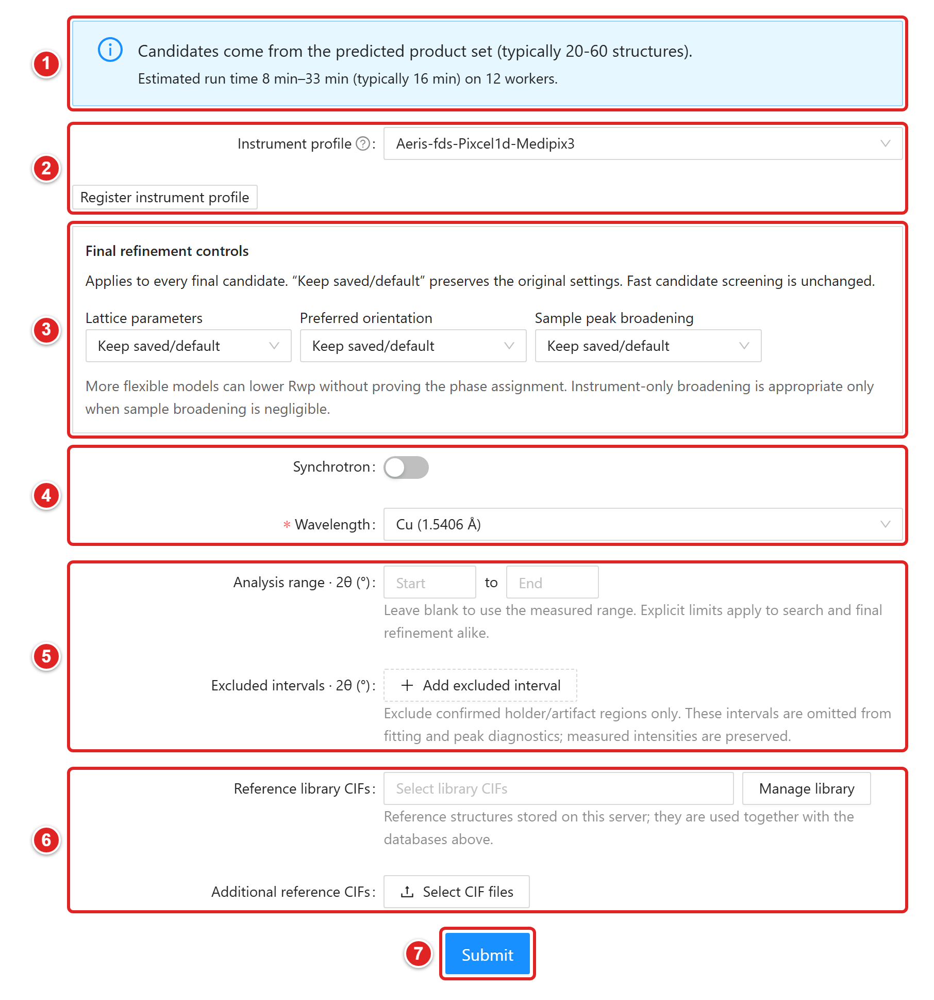{height=460}

(1) 예상 후보 수와 Estimated run time 안내. 조건을 바꾸면 갱신됨.
(2) Instrument profile: 장비 조건 선택. 맞는 항목이 없으면 Register instrument profile로 등록.
(3) Final refinement controls: Lattice parameters, Preferred orientation, Sample peak broadening.
(4) Synchrotron / Wavelength: 광원과 파장 지정.
(5) Analysis range · 2θ (°) / Excluded intervals · 2θ (°): 분석 범위와 제외 구간.
(6) Reference library CIFs / Additional reference CIFs: 참조 CIF 추가.
(7) Submit: 누른 뒤 확인 창에서 확정하면 작업 생성.

### 속도 조절 3종

<!-- widths: 140,347 -->
| 항목 | 동작 |
| --- | --- |
| Candidate pre-filter | 기본 켜짐. 계산 패턴의 강한 피크가 측정 패턴에 없으면 그 참조 구조를 미리 제외. 업로드·라이브러리·전구체 상은 제외 대상이 아님. 벤치마크 60개 시료에서 정답 상 유지율 100%. |
| Reference screening limit (s) | 선별 단계에서 참조 하나에 쓰는 BGMN 최대 시간. 기본 300 s, 입력 범위 60~1200. 아주 큰 구조는 두 배(최대 1200 s)까지 허용. 비우면 원래 값 1200 s. |
| Maximum analysis time (min) | 5~720분. 시간이 지나면 탐색을 멈추고 그때까지의 최선 결과를 미완료 표시와 함께 반환. 비우면 제한 없음. |

### 예상 시간

조건을 바꿀 때마다 예상 후보 수와 실행 시간 범위가 갱신됨. 예: "Estimated run time 8 min–33 min (typically 16 min) on 12 workers". 후보가 많으면 줄이는 방법도 함께 제안함. 대략적인 값이므로 PC 사양과 구조 크기에 따라 달라짐.

### 장비 프로파일과 파장

Instrument profile에서 실제 장비 조건을 선택. 목록에는 operator verified / unverified가 함께 표시됨. 맞는 항목이 없으면 Register instrument profile에서 Compiled GEQ (required)와 Matching GER (optional)을 올려 등록. 등록은 파일을 들여오는 일이고 교정은 아니므로 표준시료 피팅으로 따로 확인 필요. 실험실 광원은 Wavelength에서 Cu, Co, Cr, Fe 등 선택. Synchrotron을 켜면 Wavelength (nm)에 직접 입력(1 Å = 0.1 nm).

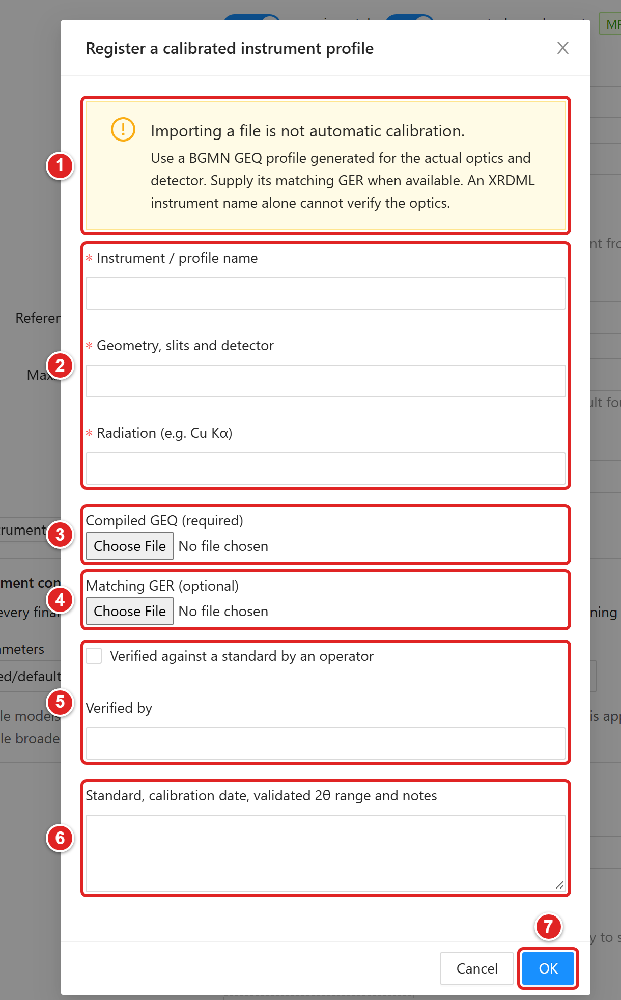{height=400}

(1) 파일을 들여오는 것은 자동 교정이 아니라는 안내.
(2) Instrument / profile name, Geometry, slits and detector, Radiation (e.g. Cu Kα): 필수 입력.
(3) Compiled GEQ (required): 실제 광학계·검출기용 BGMN GEQ 파일. 필수.
(4) Matching GER (optional): 짝이 되는 GER 파일. 있으면 함께 올림.
(5) Verified against a standard by an operator / Verified by: 표준시료 확인 여부와 확인자.
(6) Standard, calibration date, validated 2θ range and notes: 표준시료, 교정일, 검증 범위 메모.
(7) OK: 등록 실행.

### 파장 불일치 확인

XRDML에 기록된 파장과 선택한 파장이 다르면 제출할 때 "The selected wavelength differs from the file" 창이 뜸. Submit anyway 또는 Go back and check 중 선택. 어느 쪽 값도 몰래 바꾸지 않음.

### 2θ 범위와 제외 구간

Analysis range · 2θ (°)를 비우면 측정 범위 전체 사용. 홀더나 장비 아티팩트가 확인된 위치만 Add excluded interval로 제외. 제외 구간은 피팅과 피크 진단에서 빠지지만 원본 강도는 그대로 보존됨. 범위나 제외 구간이 다른 작업끼리는 Rwp를 직접 비교하지 말 것.

### 최종 정밀화 조건

Final refinement controls의 Lattice parameters, Preferred orientation, Sample peak broadening은 처음엔 Keep saved/default 유지. 결과에서 구체적인 문제를 확인한 뒤 한 항목씩 바꿔 비교. 자유도를 늘려 Rwp가 내려가도 상 동정이 입증되지는 않음.

### 참조 CIF 넣기

Reference library CIFs는 서버에 저장해 두고 여러 작업에서 다시 쓰는 구조. Manage library → Add CIF to library로 추가. Additional reference CIFs(Select CIF files)는 이번 작업에만 쓰는 구조. 같은 상의 CIF를 여러 개 넣으면 정량값이 쪼개지므로 상 하나에 하나만 넣을 것.

### 제출과 조건 재사용

맨 아래 Submit을 누르고 확인 창에서 확정. 기존 작업 페이지의 Copy conditions & rerun을 누르면 원래 패턴과 조건이 채워진 Submit 화면이 열림. 바꿀 항목만 고쳐 제출하면 원본 작업은 그대로 둔 채 새 작업이 생김.

## 05 시리즈 분석

### 언제 쓰나

온도별, 시간별, 조성별처럼 같은 조건으로 측정한 패턴 여러 개를 한 번에 분석하고 추세를 볼 때 사용.

### 제출 방법

- Submit 화면에서 Submit as a series를 켬.
- Series name 입력 후 XRD patterns에 파일 2~50개를 한꺼번에 올림. 형식과 측정 조건이 같아야 함.
- Series order preview에 파일 이름에서 읽은 변수(예: 200 °C, 60 min)와 순서가 표시됨. 이 값은 그래프 축에만 쓰이고 분석에는 영향 없음.
- 나머지 분석 조건은 단일 패턴과 같음. 각 파일은 같은 설정의 독립 작업으로 처리됨.

### 시리즈 페이지

상단 Series 메뉴에서 시리즈를 고르면 작업 표와 추세 그래프 3종이 나옴. Phase fractions는 상별 wt%와 BGMN 추정 표준편차 오차막대, Lattice parameters는 상과 파라미터를 골라 변화 추적, Fit quality는 시료별 Rwp와 GOF. 추세 그래프는 완료된 작업이 2개 이상일 때 그려짐. Export CSV로 표를 받고, Compare patterns로 패턴을 겹쳐 볼 수 있음.

> 이 설명서 작성 시점의 서버에는 시리즈 작업이 없어 화면 그림은 생략함.

## 06 결과 보기

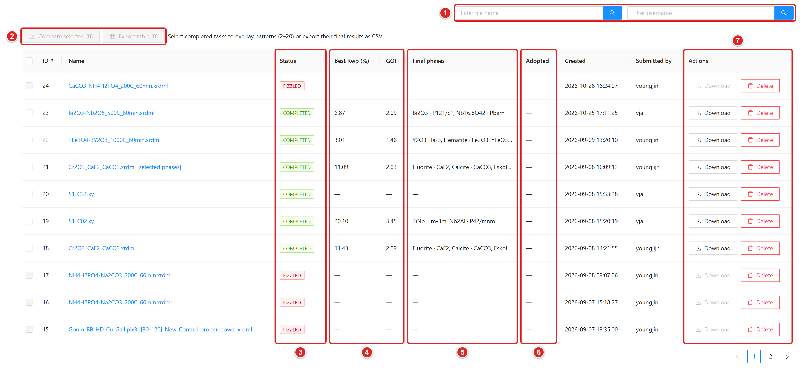{height=270}

(1) Filter file name / Filter username: 파일 이름·사용자로 검색.
(2) Compare selected / Export table: 체크한 작업 겹쳐 보기, 결과 표 CSV 저장.
(3) Status: 작업 상태 태그(COMPLETED, FIZZLED 등).
(4) Best Rwp (%) / GOF: 최저 Rwp 결과의 적합도.
(5) Final phases: 최종 정밀화된 상.
(6) Adopted: 채택 결과 여부.
(7) Actions: 결과 Download, 작업 Delete.

### Results 목록

열 구성은 ID #, Name, Status, Best Rwp (%), GOF, Final phases, Adopted, 시리즈 이름. Filter file name과 Filter username으로 검색. 완료 작업을 체크한 뒤 Compare selected(2~20개 패턴 겹쳐 보기) 또는 Export table(CSV) 사용.

| Status | 의미 |
| --- | --- |
| READY / RUNNING | 대기 중 / 분석 중. 작업 페이지에서 진행 단계와 후보 처리 수 확인. 필요하면 Stop analysis |
| COMPLETED | 완료. 신뢰도 배너부터 확인 |
| FIZZLED | 실패. 태그에 마우스를 올리면 원인 요약과 조치 힌트 표시 |
| CANCELLING / CANCELLED | 중단 처리 중 / 중단됨 |

### 작업 페이지 첫 화면

위쪽 버튼 줄에 Copy conditions & rerun, Download all, Download all results, Table (CSV), Figure (PNG), Figure (SVG), Export for... 배치. 그 아래 신뢰도 배너, Adopted result & lab notes, 조건·품질 표 순서.

## 06 결과 보기 · 신뢰도 판정

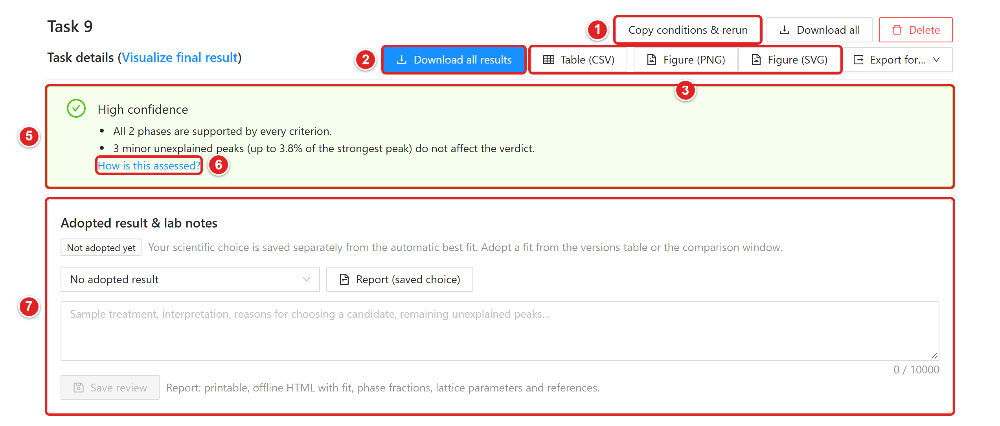{height=300}

(1) Copy conditions & rerun: 같은 패턴·조건으로 Submit 화면 열기.
(2) Download all results: 계산 산출물 전체 ZIP.
(3) Table (CSV), Figure (PNG), Figure (SVG): 결과 표와 피팅 그림 저장.
(4) Export for...: Profex, TOPAS, GSAS-II, HighScore용 내보내기.
(5) 신뢰도 배너. 등급과 그 등급을 정한 이유 표시.
(6) How is this assessed?: 판정 기준 설명 열기.
(7) Adopted result & lab notes: 채택 후보 선택과 메모.

### 신뢰도 배너

배너 아래 항목이 그 등급을 정한 이유. How is this assessed?를 누르면 기준 설명이 열림. 확률이 아니라 통계량에 대한 문턱값 판정임.

| 등급 | 조건(하나라도 해당하면 그 등급) |
| --- | --- |
| High confidence | 아래 두 등급 조건에 하나도 해당하지 않음. GOF 3 이하, significant 미설명 피크 없음, 모든 상 Confident. |
| Check recommended | Ambiguous 또는 Weak evidence 상 존재(5 wt% 미만), GOF 3 초과, significant 피크 1~3개, 시료 변위 Warning, 넓은 배경 언덕, 선별 시간 초과 참조 존재, 최대 분석 시간에 걸려 중단. |
| Expert review recommended | 5 wt% 이상 상이 Weak evidence, significant 피크 4개 이상 또는 높이 합 20% 이상, Rwp 25% 초과, GOF 4 초과, 시료 변위 Severe, 최종 정밀화 절반 이상 실패, 참조 25% 이상 미선별. |

### 상별 판정(Verdict)

정밀화된 상마다 Confident, Ambiguous, Weak evidence 중 하나가 붙음. 태그에 마우스를 올리면 근거 수치가 보임.

- 후보 모델 60% 이상에 등장하면 존재 근거로 인정.
- wt%를 표준편차로 나눈 값이 3 이상이면 Confident 쪽, 2 미만이면 Weak. 1 wt% 미만도 Weak.
- 그 상이 빠진 다른 후보의 Rwp가 max(0.5%p, Rwp의 5%) 안이면 Ambiguous. 툴팁에 대안 후보 이름 표시.
- Hamilton 검정(α = 0.01)으로 그 상이 피팅을 유의하게 개선하는지 확인.
- MP 계산 구조는 격자가 참조값에서 1.5% 넘게 움직이면 감점. 격자가 정밀화 한계에 닿은 경우는 모든 상에서 표시.

## 06 결과 보기 · 피크, 주의, 변위

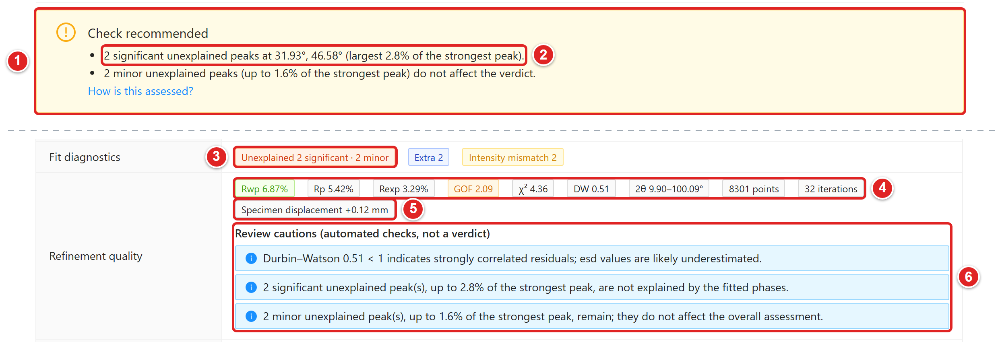{height=320}

(1) Check recommended 배너.
(2) 등급을 낮춘 이유: significant 미설명 피크 2개(31.93°, 46.58°).
(3) Fit diagnostics의 Unexplained 태그: significant·minor 피크 수.
(4) Refinement quality 지표: Rwp, Rp, Rexp, GOF, χ², DW, 2θ 범위, 데이터 점 수, 반복 수.
(5) Specimen displacement 태그: 시료 변위(mm).
(6) Review cautions (automated checks, not a verdict): 자동 점검 결과 모음.

### 미설명 피크 등급

Fit diagnostics의 Unexplained 태그는 계산 패턴이 재현하지 못한 관측 피크 수. 각 피크를 평활 잔차의 높이(최강 피크 대비)와 S/N으로 분류함.

<!-- widths: 90,397 -->
| 등급 | 기준과 영향 |
| --- | --- |
| significant | 최강 피크의 2% 이상이면서 S/N 8 이상. 등급 판정에 반영되는 유일한 종류 |
| minor | noise와 significant 사이. 정보로만 표시하고 등급은 바꾸지 않음 |
| instrument | 강한 반사의 Cu Kβ, W Lα1 위치와 일치하는 약한 피크. 장비 유래 가능성 |
| noise | 최강 피크의 0.5% 미만이거나 S/N 3 미만 |

minor·significant 피크 위치가 후보 구조, 입력 구조, 로컬 COD 캐시의 어떤 상과 맞으면 "Positions are consistent with trace ..." 형태로 미량상 후보를 알려 줌. 이 힌트는 판정에 반영되지 않음. 해당 상을 넣고 다시 정밀화해 볼 가치가 있는지는 힌트를 출발점 삼아 판단.

### Review cautions

Refinement quality 아래 "Review cautions (automated checks, not a verdict)"에 자동 점검 결과가 모임. 예: Durbin–Watson이 1 미만이면 잔차 상관이 강해 esd가 과소평가됐을 가능성, 넓은 배경 언덕, 미설명 피크 요약.

### 시료 변위(Specimen displacement)

BGMN의 EPS2를 장비 프로파일의 고니오미터 반경으로 환산해 mm 단위로 표시(s = EPS2 × R). 0.3 mm 이하 OK, 0.3 mm 초과 Info, 1.0 mm 초과 Warning, 2.0 mm 초과 또는 정밀화 한계 도달 시 Severe. 변위가 크면 모든 피크가 함께 밀리므로 격자상수와 상 매칭을 조심해서 읽어야 함. 시료 높이와 장비 프로파일부터 재확인.

## 06 결과 보기 · 후보 비교와 재정밀화

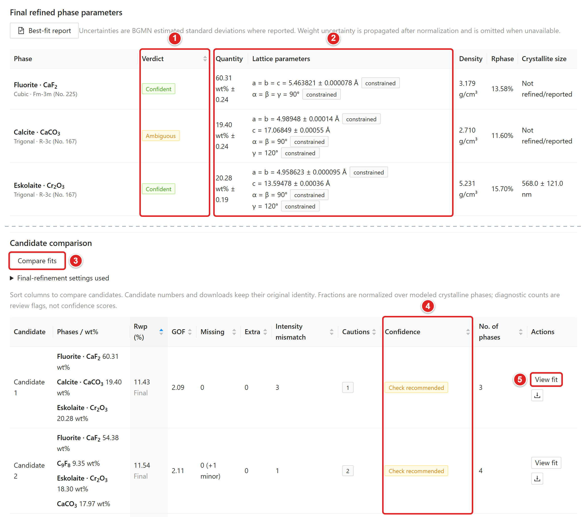{height=330}

(1) Edit phases: 상 선택 재정밀화 창 열기.
(2) Verdict: 상별 판정(Confident, Ambiguous, Weak evidence).
(3) Quantity / Lattice parameters: wt%와 격자상수, 표준편차.
(4) Compare two candidate fits: 두 후보 피팅 겹쳐 보기. 후보가 둘 이상일 때 사용 가능.
(5) Confidence: 후보별 신뢰도 태그. 열 머리글로 정렬 가능.
(6) View fit / Adopt: 후보 피팅 보기와 채택.

### 후보 비교

Candidate comparison 표는 Rwp, GOF, Missing, Extra, Intensity mismatch, Cautions, Confidence 열로 정렬 가능. 모든 후보에 같은 기준의 신뢰도 태그가 붙으므로 대안 상 조합도 같은 눈금으로 비교됨. 후보가 둘 이상이면 Compare two candidate fits로 두 피팅을 같은 2θ 축에 겹쳐 보고 차이가 큰 위치로 바로 이동함.

### 채택과 메모

Adopted result & lab notes에서 과학적으로 맞다고 판단한 후보를 고르고 메모를 적은 뒤 Save review. 자동 최저 Rwp 결과와 채택 결과는 따로 저장됨. View adopted fit으로 채택한 피팅을 다시 확인.

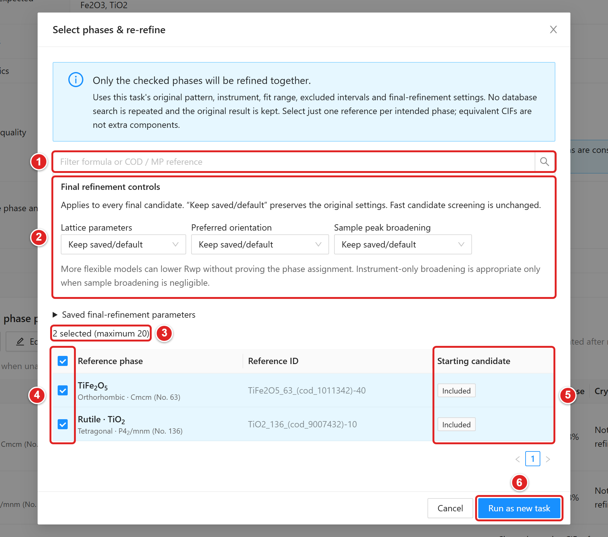{height=380}

(1) 화학식이나 COD / MP 참조 ID로 목록 거르기.
(2) Final refinement controls: 새 작업에 쓸 최종 정밀화 조건.
(3) 선택한 상 수 표시(최대 20).
(4) 체크박스: 함께 정밀화할 상 선택.
(5) Starting candidate: 원래 후보에 들어 있던 상은 Included 표시.
(6) Run as new task: 새 작업으로 실행. 원래 결과는 유지.

### 선택 상 재정밀화

Final refined phase parameters의 Edit phases를 누르면 저장된 참조 상 목록이 열림. 넣을 상만 체크하고 Run as new task. 원래 패턴, 장비, 2θ 범위, 제외 구간, 최종 정밀화 설정을 그대로 쓰며 DB 검색은 반복하지 않음. 원래 결과는 유지되고 새 작업이 생김. 미량상 힌트가 나온 상을 추가하거나 의심스러운 상을 빼서 비교할 때 유용함.

## 07 보고서와 내보내기

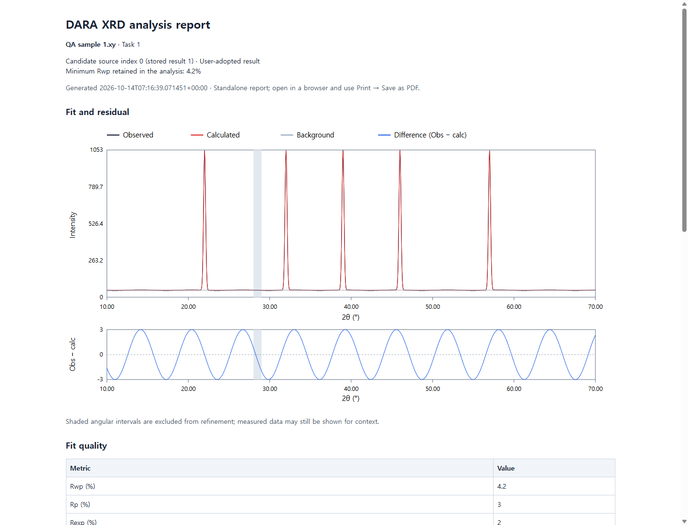{height=330}

(1) 제목과 작업 정보: Task 번호, 생성 시각, 최저 Rwp.
(2) Summary: 종합 판정과 상별 정량 요약.
(3) Experimental and methods: 측정·정밀화 방법 문단.
(4) Recorded settings: 기록된 분석 조건 표.

### 논문형 보고서

Best-fit report는 최저 Rwp 결과, Report (saved choice)는 채택한 후보(없으면 최저 Rwp)를 보고서로 내보냄. 인터넷 없이 열리는 단일 HTML 파일이며 Summary, Experimental and methods, Results, 표, 그림, 참고문헌으로 구성. 방법 문단에는 DARA·BGMN 버전, 파장, 고니오미터 반경, 데이터 범위, 정밀화 변수가 문장으로 들어가 논문 초안에 옮기기 쉬움. PDF가 필요하면 브라우저에서 열고 Ctrl+P → PDF로 저장.

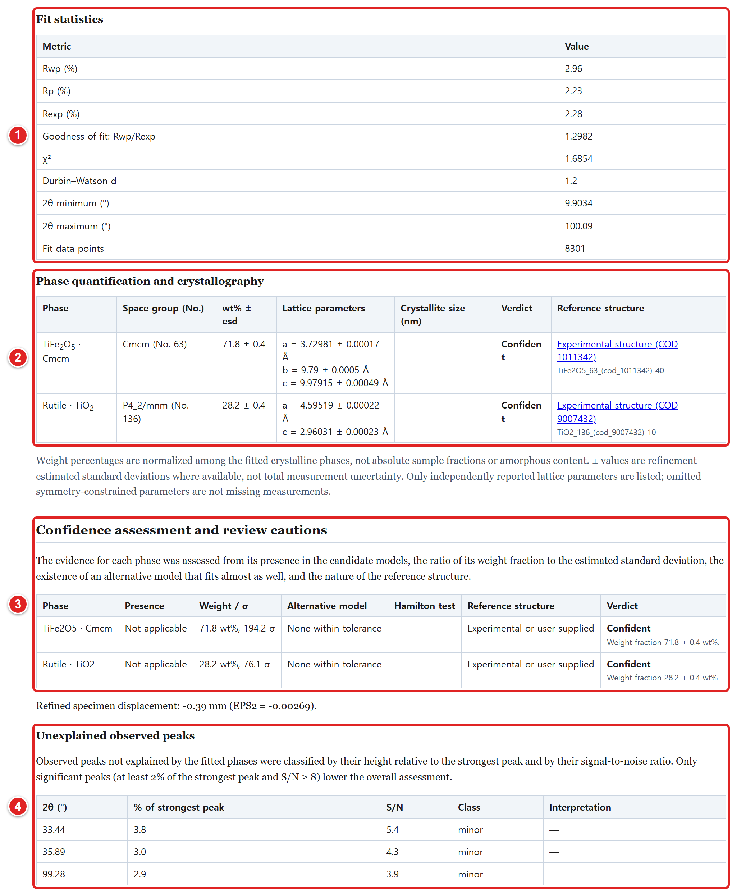{height=450}

(1) Fit statistics: Rwp, Rp, Rexp, GOF, χ², Durbin–Watson, 2θ 범위, 데이터 점 수.
(2) Phase quantification and crystallography: 상별 wt% ± esd, 격자상수, 판정, 참조 구조.
(3) Confidence assessment and review cautions: 상별 판정 근거 표.
(4) Unexplained observed peaks: 미설명 피크의 위치, 상대 높이, S/N, 등급.

### 그림과 표

- Figure (PNG): 600 dpi 피팅 그림. 관측·계산·배경·차이 곡선과 상별 Bragg 위치 포함.
- Figure (SVG): 같은 그림의 벡터 버전. 논문 편집용.
- Table (CSV): 상별 wt%, 표준편차, 격자상수, 품질 지표, 미설명 피크 등급 수. Results 목록의 Export table은 여러 작업을 한 표로 묶음.

### 외부 프로그램용 내보내기

결과를 다른 프로그램에서 이어서 검토하거나 수정하려면 Export for... 메뉴에서 선택.

<!-- widths: 170,317 -->
| 메뉴 항목 | 내용 |
| --- | --- |
| Profex / BGMN (.sav + .str) | Profex에서 바로 여는 프로젝트와 구조 파일 |
| TOPAS (.inp starting model) | TOPAS 시작 모델 입력 파일 |
| GSAS-II (CIF + data) | 정밀화된 CIF와 패턴 데이터 |
| HighScore (CIF + data) | 정밀화된 CIF와 패턴 데이터 |

Download all results는 계산 산출물 전체(.lst 포함)를 ZIP으로 묶음. 원본 측정 파일, 사용한 CIF, 장비 조건, 보고서와 함께 시료별 폴더에 보관하면 재검토가 쉬움. 서버 데이터는 사용자 홈의 .dara-server 폴더에 있으며 Git 저장소와 별개임.

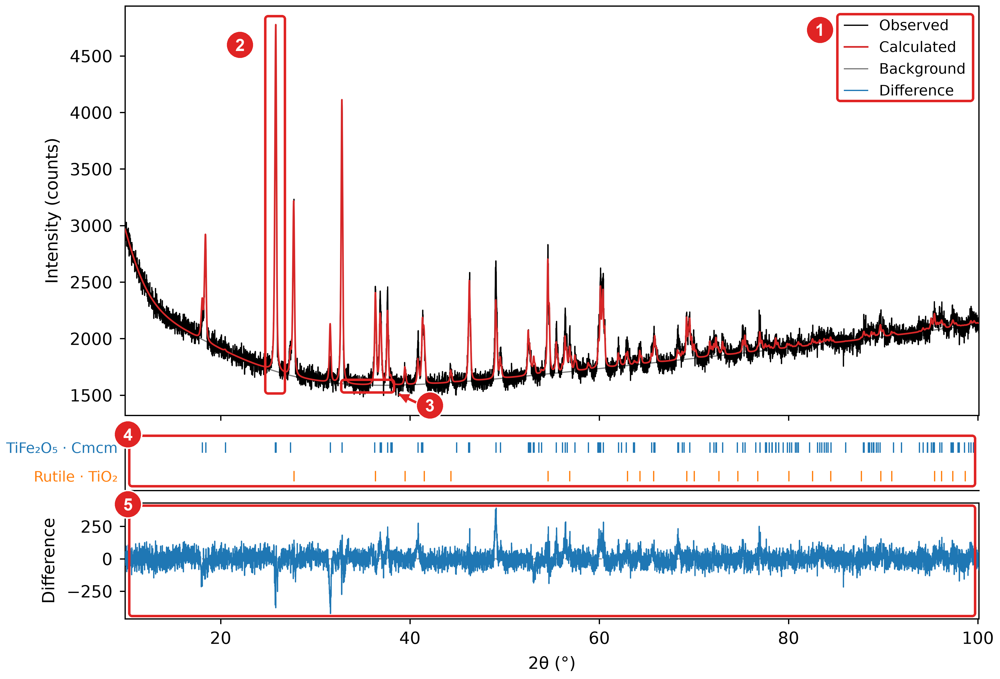{height=330}

(1) 범례: Observed, Calculated, Background, Difference.
(2) 관측(검은색)과 계산(빨간색) 패턴. 가장 강한 반사 부근 예시.
(3) Background: 회색 배경 곡선.
(4) 상별 Bragg 반사 위치(tick).
(5) Difference: 관측값에서 계산값을 뺀 차이 곡선.

## 08 결과 해석 시 주의

### wt%는 상대값

정량값은 모델에 포함된 결정상끼리 합이 100%가 되도록 정규화한 값. 비정질이나 동정되지 않은 물질은 빠져 있음. 시료 전체의 절대 함량으로 읽으면 안 됨. 배경에 넓은 언덕이 보이면 비정질 성분을 의심.

### 불확도의 범위

표시되는 ± 값은 최소제곱 피팅의 BGMN 추정 표준편차. 우선 배향, 미세흡수, 시료 변위, 잘못된 구조 모델, 입자 통계 같은 계통 오차는 포함되지 않음. Durbin–Watson 주의가 뜨면 실제 불확도는 더 큼.

### 계산 구조(MP) 사용 시

MP 구조는 실험 구조보다 격자가 몇 % 어긋나는 일이 흔함. DARA는 실험 구조를 먼저 쓰고, MP 구조는 격자 허용 범위를 넓혀 정밀화함. 최종 상이 계산 구조뿐이면 같은 화학식의 실험 CIF를 찾아 재정밀화해 보는 편이 안전함.

### DB에 없는 상은 못 찾음

후보는 COD, MP, 사용자가 넣은 CIF에서만 나옴. 어디에도 없는 상은 탐색 불가. significant 미설명 피크가 남으면 원소 목록 누락이나 새로운 상 가능성을 검토.

### 자동 결과는 검토 대상

High confidence도 정답 보증이 아님. 시료 이력, 합성 조건, 가능하면 다른 분석법(SEM-EDS, XRF 등) 결과와 대조. 낮은 Rwp 하나로 상 조합을 확정하지 말고 미설명 피크, 강도 차이, 판정 근거를 함께 볼 것. 최종 판단과 채택 근거는 lab notes에 남겨 둘 것.

## 09 문제 해결

<!-- widths: 140,347 -->
| 상황 | 확인과 대처 |
| --- | --- |
| 첫 실행이 실패함 | 인터넷과 프록시 확인 후 START.cmd 재실행. 받은 파일은 재사용됨. 원인은 START 창의 마지막 메시지와 artifacts\launcher\setup-*.log에서 확인. 종료 코드 2는 인터넷 없음, 3은 BGMN 다운로드 실패, 4는 uv 다운로드·검증 실패, 6은 패키지 설치 실패. |
| 폴더를 옮긴 뒤 실행 안 됨 | START가 이동을 감지해 환경을 자동 재구성함. 그래도 안 되면 START.cmd -Reinstall 또는 .venv 폴더 삭제 후 재실행. |
| MP key rejected / not configured | START.cmd 재실행 시 키를 다시 입력하거나 Windows 환경변수 MP_API_KEY 확인. 급하면 MP 스위치를 끄고 COD와 CIF로 분석. |
| 서버가 혼자 꺼짐 | 모든 DARA 창을 닫으면 약 20초 뒤 정상 종료되는 동작임. 분석 중에는 꺼지지 않음. 다시 쓰려면 START.cmd 실행. |
| 웹 화면이 안 열림 | http://localhost:8898을 직접 입력. 회사 프록시가 로컬 주소를 가로채는지 확인. START는 기본 브라우저 실패 시 Edge나 Chrome을 시도함. |
| 분석이 너무 느림 | 먼저 예상 시간 확인. 전구체를 알면 Reaction check가 가장 빠름. Candidate pre-filter 켜기, MP 구조 수 줄이기, Maximum analysis time 지정(중간 최선 결과 반환), 2θ 범위 좁히기 순으로 시도. |
| COD 연결 오류 | "Network error while contacting a structure database"가 뜨면 인터넷·프록시 확인. 이전에 받은 구조는 로컬 캐시에서 재사용되고 일부 다운로드 실패는 건너뜀. 계속 실패하면 필요한 CIF를 직접 올려 분석. |
| CERTIFICATE_VERIFY_FAILED, CODDownloadError | 기관망처럼 HTTPS를 검사하는 네트워크에서 발생. START.cmd가 Windows 인증서 저장소와 certifi를 합친 CA 묶음(tools\certs\dara-ca-bundle.pem)을 만들어 서버에 넘기므로 START.cmd로 다시 실행. 끄려면 환경변수 DARA_CA_BUNDLE=off. |
| No candidate structures were found | 원소 목록, COD/MP 스위치 확인. 그래도 없으면 참조 CIF 업로드. |
| BGMN refinement program failed | 이상한 CIF나 프로파일·파장 불일치가 흔한 원인. 의심 CIF를 빼고 장비 프로파일 확인. |
| The parallel worker (Ray) could not start | 다른 DARA 창을 닫거나 PC 재시작. 보안 프로그램이 로컬 포트를 막는지 확인. |
| 피팅이 나쁨 | 파장, 장비 프로파일, 원소 목록, 후보 CIF, 분석 범위 순으로 점검. Rwp를 낮추려고 중요한 피크를 제외 구간으로 지우지 말 것. |

### 폴더 안내

START.cmd만 실행하면 됨. src, scripts, pyproject.toml은 실행에 필요하므로 지우거나 옮기지 말 것. tools와 .venv는 첫 실행 때 생기는 폴더이며 Git에 올라가지 않음. artifacts에는 로그와 시험 출력이 쌓임. 분석 DB는 사용자 홈의 .dara-server에 있으므로 백업은 서버를 끈 뒤 그 폴더를 따로 복사.

> 문서 근거: README.md, docs/user-guide/results-confidence.md, scripts/start_dara_web.ps1, src/dara/server 소스. PDF 재생성: python docs/user-guide/build_manual.py(reportlab 필요).
